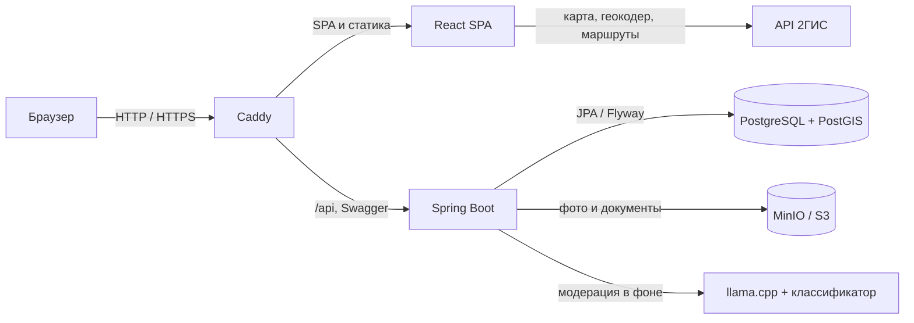

<div align="center">

# Движ

### Платформа совместных спортивных активностей

Финал Чемпионата России по продуктовому программированию, кейс Столото.
Помогает перейти от «хочу заниматься, но не с кем» к конкретной встрече: кто собирается, где, когда и как
присоединиться.

|        Стенд         |               Адрес                |
|:--------------------:|:----------------------------------:|
|     **Основной**     | **[42team.ru](https://42team.ru)** |
| **Резервный, по IP** |   `http://<IP>` — появится позже   |


[Запуск](#запуск) · [Демо-аккаунты](#демо-аккаунты) · [Ограничения](#что-имитировано-и-ограничения) · [Тесты](#тесты) · [Документация](#документация)

</div>

> Демо-стенд. Пользователи, клубы, встречи и отзывы вымышлены; монеты и вещи бобра не имеют денежной ценности.

## Что есть сейчас

- Полный путь участника: лента и карта → карточка встречи → запись или заявка → «Вы записаны» и приватные детали →
  обсуждение.
- Одна модель для всех видов спорта. Свой вид («Петанк», «Сапсёрфинг») создаётся прямо из формы встречи, без правки
  кода.
- Три роли: пользователь, организация (клуб, федерация, компания) и администратор. Организатором встречи может быть
  пользователь или допущенная организация.
- Запись свободная или по заявке, лимит мест, лист ожидания, кворум «состоится, если наберём N», соорганизаторы.
- Повторяющиеся встречи по RRULE: одна карточка серии, отметка «приду» на каждое занятие, перенос и отмена занятий.
- Допуск организаций: анкета → проверка администратором → публичная страница клуба и публикация встреч без повторной
  модерации.
- Админка: допуск и отзыв организаций, снятие и удаление встреч с причиной, очередь модерации текстов, пользователи,
  виды спорта.
- Модерация в два слоя: словарь не даёт сохранить мат, а в фоне тексты проверяют классификатор токсичности и локальная
  нейросеть.
- Карта встреч на 2ГИС с кластерами и поиск «рядом», персональная подборка с объяснением причин.
- Блог: гайды и посты с прошедших встреч с фото, лайки и комментарии.
- Мягкая геймификация: бобр-питомец, монеты за посещения, достижения, «Организация месяца».

## Запуск

### Требования

- Docker Engine 24+ и Docker Compose v2;
- свободный порт `8080` (и `8443`, если нужен HTTPS);
- при первом старте из интернета скачиваются модели модерации, около 0,5 ГБ.

Из корня репозитория:

```bash
docker compose up --build
```

Первая сборка занимает 2–3 минуты. Приложение открывается сразу после старта, демо-аккаунты появляются в первые секунды,
а остальные демо-данные дописываются в фоне ещё около трёх минут — до строки `Demo data seeded` в логе.

| Что          | Адрес                                   |
|--------------|-----------------------------------------|
| Приложение   | <http://localhost:8080>                 |
| Swagger UI   | <http://localhost:8080/swagger-ui.html> |
| OpenAPI      | <http://localhost:8080/v3/api-docs>     |
| Health-check | <http://localhost:8080/actuator/health> |

Если порт занят:

```bash
PORT=8088 docker compose up --build
```

Карта и подсказки адресов работают с ключом API 2ГИС (бесплатный). Без ключа можно создавать онлайн-встречи, а очным
нужны координаты:

```bash
VITE_2GIS_KEY=<ключ> docker compose up --build
```

Остановить и стереть все данные (демо пересоздастся при следующем старте):

```bash
docker compose down -v
```

## Демо-аккаунты

Пароль у всех `demo-password-1`. На странице входа есть кнопки, которые подставляют логин и пароль в обычную форму.

| Логин    | Роль                     | Для чего                                                                 |
|----------|--------------------------|--------------------------------------------------------------------------|
| `anna`   | пользователь             | новичок: ищет встречи, записывается, задаёт вопросы                      |
| `petr`   | пользователь             | организатор встречи «по заявке» и серии «Баскетбол по вечерам»           |
| `vika`   | пользователь             | провела 90 встреч, у её бобра весь гардероб                              |
| `ladya`  | организация, допущена    | шахматный клуб «Ладья»: публикует встречи сразу, есть публичная страница |
| `enisey` | организация, на проверке | беговое сообщество «Енисей»: видит статус заявки, публиковать не может   |
| `admin`  | администратор            | допуск организаций, снятие встреч, модерация                             |

Без кнопок можно войти под `olga` (пенсионерка, зарядка во дворе), `dmitry`, `elena`, `sergey`, `nikolai`, `yoga`
(заявка отклонена) и `bobry` (студенческий клуб).

Кроме героев сценариев демо создаёт «живой проект»: около 260 пользователей в 12 городах, больше 20 клубов во всех
статусах, около 400 встреч на реальных площадках, записи, обсуждения, блог и фото. Всё создаётся через те же сервисы,
что и REST API.

### Модерация текстов

1. **До сохранения** — словарь. Мат, в том числе замаскированный, не сохраняется: сообщения, встречи, профиль, анкета
   клуба. Ответ `400`.
2. **После сохранения, в фоне** — три голоса: словарь, классификатор токсичности (rubert-tiny-toxicity) и нейросеть
   Qwen3.5-0.8B на CPU.
3. Сообщение скрывается само, только если серьёзное нарушение (угроза, травля, ненависть, непристойность, реклама
   заработка) видят минимум двое из трёх. Сомнительное и «не по теме» уходит в очередь «Админка» → «Модерация».
4. Администратор скрывает или возвращает любое сообщение с причиной. В обсуждении остаётся заглушка, причину видит
   автор.

Подробнее: [docs/moderation.md](docs/moderation.md).

## Что имитировано и ограничения

- Нет подтверждения почты, восстановления пароля и OAuth.
- Допуск организации — решение админа, без проверки по реестрам.
- Email и MAX имитированы; Telegram — настоящий бот при заданном токене.
- Прошедшие встречи демо создаются будущими, потом даты переносятся назад.
- Модели модерации маленькие и ошибаются, решает админ. Образ PostGIS — только amd64.

## Дополнительные функции

| Функция                                                                     | Где посмотреть                                                                   |
|-----------------------------------------------------------------------------|----------------------------------------------------------------------------------|
| Карта встреч с кластерами, поиск «рядом»                                    | «Лента» → карта                                                                  |
| Подборка «Подобрали для тебя» с причинами и «Не интересно», похожие встречи | «Главная», карточка встречи · [docs/recommendations.md](docs/recommendations.md) |
| Онбординг: интересы, уровень, удобное время, радиус, дом                    | после регистрации                                                                |
| Повторяющиеся встречи, кворум, лист ожидания, соорганизаторы                | «Баскетбол по вечерам», «Настольный теннис: один стол на двоих»                  |
| Онлайн-формат: ссылку видят только участники                                | «Лента» → фильтры → «Формат»                                                     |
| «Поделиться»: картинка 1080×1350 с QR, ссылки для мессенджеров, `.ics`      | карточка встречи                                                                 |
| Каталог организаций, подписки на анонсы, страница клуба со статистикой      | меню аккаунта → «Организации» · [docs/organizations.md](docs/organizations.md)   |
| Блог: гайды и посты с встреч, фото, лайки, комментарии                      | «Блог»                                                                           |
| Альбом фото по прошедшим встречам                                           | профиль                                                                          |
| Бобр-питомец, монеты, магазин, достижения, «Организация месяца»             | профиль · [docs/economy.md](docs/economy.md)                                     |
| «Когда выходить» на ближайшую встречу по маршрутам 2ГИС                     | «Главная» · [docs/notifications.md](docs/notifications.md)                       |
| Устанавливаемое PWA                                                         | меню браузера → «Установить»                                                     |

## Архитектура



Бэкенд разложен по слоям, зависимости только вниз: `rest → service → repository → domain`. Наружу отдаются только DTO,
права проверяются в сервисах. Клиент API для фронта генерирует Orval из OpenAPI, руками запросы не пишутся.
Пространственные запросы (карта, «рядом») — нативный SQL на PostGIS, остальное — JPQL.

```
backend/    com.hackathon.app: rest, service, repository, domain (entity, dto, mapper, enums), demo
frontend/   src: app (маршруты), pages, widgets, features, entity, shared (ui, api)
deploy/     docker-compose и Caddyfile для сервера
docs/       подробная документация
```

## Локальная разработка

Нужны Java 25, Node.js 22+, Yarn и Docker.

```bash
make dev     # Postgres :5440 и MinIO :9440 в Docker
make back    # бэкенд :8080
make front   # фронт :5173, /api проксируется на бэкенд
```

Без `make`: `node scripts/dev.mjs back` и `node scripts/dev.mjs front`, работает и на Windows.

Демо-сид запускается только на пустой базе. Пересоздать локальную базу:

```bash
docker compose -f docker-compose.dev.yml down -v && make dev
```

Поменяли API → поднять бэкенд → `cd frontend && yarn api:sync` → закоммитить `openapi.json` и `generated/`.

## Тесты

```bash
cd backend && ./gradlew test          # e2e-сценарии на H2, без Docker
cd backend && ./gradlew postgresTest  # миграции Flyway на настоящем PostgreSQL (нужен Docker)
cd backend && ./gradlew check         # оба, как в CI
cd frontend && yarn typecheck
```

97 тестов, почти все — e2e: `@SpringBootTest` + MockMvc, весь контекст и настоящая цепочка Spring Security,
своё ничего не мокается. Тест проходит пользовательский путь целиком через HTTP, как браузер: регистрация,
вход по cookie, действие, ответ. Пишутся через тестовый API `e2e/support`:

```java
var petya = api.newUser("petya");
var author = api.newUser("author");
var eventId = author.createEvent(EventForm.free().sport("Футбол")).id();
petya.

joinEvent(eventId);

assertThatApi(() ->petya.

joinEvent(eventId)).

fails(CONFLICT, "Вы уже записаны на это мероприятие");
```

| Сценарий приёмки                         | Тест                          |
|------------------------------------------|-------------------------------|
| 1. Создание встречи, свой вид спорта     | `EventCreationE2ETest`        |
| 2. Допуск организации                    | `OrganizationApprovalE2ETest` |
| 3–4. Свободная запись и запись по заявке | `RegistrationE2ETest`         |
| 5. Уточнение условий в обсуждении        | `CommentsE2ETest`             |
| 6. Снятие с публикации                   | `AdminModerationE2ETest`      |

Остальные покрывают доп. функции: серии и кворум, лист ожидания, карту, подборку, уведомления и Telegram,
модерацию текстов, бобра и магазин, галерею и альбом. Перед каждым тестом — комментарий «флоу, шаги, что
проверяем, почему важно».

Тот же путь через API на живом стенде — коллекция Postman: `make postman URL=https://42team.ru`
([docs/postman.md](docs/postman.md)).

## Стек

| Слой           | Технологии                                                                                                                          |
|----------------|-------------------------------------------------------------------------------------------------------------------------------------|
| Frontend       | React 19, React Router 7 (SPA), TypeScript, Vite, Tailwind CSS 4, shadcn/ui, TanStack Query и Form, zod, zustand, Orval, 2ГИС MapGL |
| Backend        | Java 25, Spring Boot 4.1, Spring Security (JWT в HttpOnly cookie), Spring Data JPA, MapStruct, springdoc, lib-recur                 |
| Данные         | PostgreSQL 18, PostGIS, Flyway, MinIO (S3)                                                                                          |
| Модерация      | llama.cpp + Qwen3.5-0.8B, text-embeddings-inference + rubert-tiny-toxicity                                                          |
| Инфраструктура | Docker Compose, Caddy 2, GitHub Actions → GHCR → VPS                                                                                |
| Тесты          | JUnit 5, MockMvc, H2, Testcontainers                                                                                                |

## Документация

| Документ                                                             | Содержание                                           |
|----------------------------------------------------------------------|------------------------------------------------------|
| [docs/API.md](docs/API.md)                                           | REST API по разделам, коды ошибок                    |
| [docs/CONFIG.md](docs/CONFIG.md)                                     | переменные окружения и демо-режим                    |
| [docs/architecture.md](docs/architecture.md)                         | слои бэкенда и контракт API                          |
| [docs/moderation.md](docs/moderation.md)                             | словарь, классификатор, нейросеть, очередь модерации |
| [docs/recommendations.md](docs/recommendations.md)                   | подборка встреч: признаки, веса, разнообразие        |
| [docs/organizations.md](docs/organizations.md)                       | каталог и страница организации, подписки             |
| [docs/economy.md](docs/economy.md)                                   | монеты, магазин, достижения, «Организация месяца»    |
| [docs/notifications.md](docs/notifications.md)                       | уведомления, Telegram, «когда выходить»              |
| [docs/development.md](docs/development.md)                           | локальная разработка, тесты, git-хуки                |
| [docs/deploy.md](docs/deploy.md), [docs/dev-faq.md](docs/dev-faq.md) | деплой и частые вопросы                              |

Полный список — [docs/README.md](docs/README.md).
